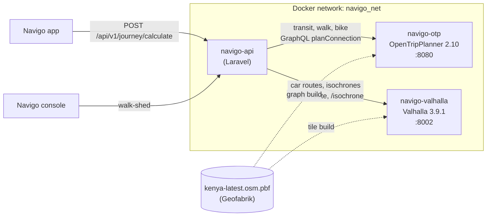

# Navigo · Valhalla Routing Engine

[](https://github.com/valhalla/valhalla)
[](https://github.com/valhalla/valhalla/pkgs/container/valhalla-scripted)
[](https://download.geofabrik.de/africa/kenya.html)
[](#endpoints)

The **car routing and isochrone engine** of [Navigo](https://navigo.co.ke): a self-hosted [Valhalla](https://github.com/valhalla/valhalla) server, built from the Kenya OpenStreetMap extract, that gives Navigo what a transit planner can't: **real alternative car routes, toll awareness for the Nairobi Expressway, and walk-shed polygons**.

It is one of Navigo's two routing engines, each in its own project so it can be deployed, rebuilt and scaled independently:

| Engine | Project | Port | Responsible for |
|---|---|---|---|
| OpenTripPlanner 2.10 | [`navigo-otp`](https://github.com/Navigo-Kenya/navigo-otp) | 8080 | Transit (matatus, buses, commuter rail, SGR), walking and cycling options, elevation |
| **Valhalla 3.9.1** | **`navigo-valhalla`** (this repo) | **8002** | **Car routes and alternatives, tolls, walk-shed isochrones** |

---

## Contents

1. [Why a second engine](#why-a-second-engine)
2. [Architecture](#architecture)
3. [What Navigo uses it for](#what-navigo-uses-it-for)
4. [Quick start](#quick-start)
5. [Performance and footprint](#performance-and-footprint)
6. [Endpoints](#endpoints)
7. [Tolls and the Nairobi Expressway](#tolls-and-the-nairobi-expressway)
8. [Configuration](#configuration)
9. [Data and tiles](#data-and-tiles)
10. [Updating the map data](#updating-the-map-data)
11. [Production deployment](#production-deployment)
12. [Operations](#operations)
13. [Troubleshooting](#troubleshooting)
14. [Roadmap](#roadmap)
15. [Credits and licences](#credits-and-licences)

---

## Why a second engine

OpenTripPlanner is excellent at public transport and good at walking and cycling, but it was never built for driving. Valhalla fills exactly those gaps:

| Need | OpenTripPlanner 2.10 | Valhalla |
|---|---|---|
| Alternative car routes | One route per request | Up to N genuine alternatives (`alternates`) |
| Avoid tolls / motorways | Not supported | `use_tolls`, `use_highways` per request |
| Live traffic speeds (later) | Not supported | Supported (traffic tiles / speed overrides) |
| Isochrones | Removed in 2.10 | Native `/isochrone` (walk, drive, cycle) |
| Map-matching GPS traces | No | `/trace_route`, `/trace_attributes` |
| Transit | **Yes, the core strength** | No (we build without transit) |

Keeping Valhalla in its own repository means:

- **Independent lifecycles:** an OTP graph rebuild (16 min, 6 GB) never takes car routing down, and vice versa.
- **Independent scaling:** Valhalla is light (≈ 75 MB at rest); it can move to a small machine or run several replicas without touching OTP.
- **A clean contract:** navigo-api talks to each engine over HTTP on the shared `navigo_net` network, nothing else is shared but the OSM extract.

---

## Architecture



Inside navigo-api, `TransitEngineService` decides which engine answers:

```text
journey request
 ├─ mode = transit / bus / rail ──► OTP (GraphQL)        ► itineraries
 ├─ mode = walk / bicycle ────────► OTP, 3 options in parallel
 └─ mode = car ───────────────────► Valhalla  (VALHALLA_URL set and reachable)
                                    └─ fallback: OTP, one route, no toll info
```

---

## What Navigo uses it for

### 1. Car routes with real alternatives

`App\Services\Routing\ValhallaService` sends two requests in parallel:

| Request | Costing | Purpose |
|---|---|---|
| `fastest` | `auto`, `alternates: 2`, `use_tolls: 0.5` | The quickest route plus up to two genuinely different ones |
| `no_tolls` | `auto`, `use_tolls: 0`, `use_highways: 0` | The best route avoiding the Expressway |

The app then shows cards such as:

| Card | Example (Kencom → JKIA) |
|---|---|
| **Fastest · via Expressway ≈ KES 190** | 63 min, 17.7 km |
| **No tolls** | 87 min, 16.9 km |

Routes are converted to the same itinerary shape the rest of the API already understands (one leg, a precision-5 polyline, turn steps), so landmarks, traffic colouring from community reports and the app's navigation engine work on them unchanged. Valhalla's own sentences ("Turn left onto Parliament Lane") become the turn instructions.

### 2. Walk-sheds in the console

OpenTripPlanner 2.10 removed its isochrone API, so `App\Services\IsochroneService::walkShed()` asks Valhalla for pedestrian isochrones (5 / 10 / 15 min by default). The response keeps the old GeoJSON shape, with `properties.time` in seconds.

### 3. Fallback behaviour

If `VALHALLA_URL` is unset, or Valhalla doesn't answer within 12 s, car journeys fall back to OTP (a single route without toll information) and walk-sheds return an empty collection with a `notice`. Navigo keeps working, just with fewer options.

---

## Quick start

### Prerequisites

| Requirement | Notes |
|---|---|
| Docker (Compose v2) | Docker Desktop on Windows/macOS, Engine on Linux |
| ~3 GB free memory during the first build | ≈ 75 MB once serving |
| ~1 GB disk | Extract (350 MB) + tiles (290 MB) + tar (290 MB) + admin/time-zone DBs |
| The shared network | `docker network create navigo_net` (once per host, shared with navigo-api and navigo-otp) |

### Run it

```bash
git clone https://github.com/Navigo-Kenya/navigo-valhalla.git
cd navigo-valhalla

# 1. The map data: the same Kenya extract navigo-otp uses
mkdir -p data
cp ../navigo-otp/graphs/default/kenya-latest.osm.pbf data/
#   or: curl -L -o data/kenya-latest.osm.pbf https://download.geofabrik.de/africa/kenya-latest.osm.pbf

# 2. Start: the first start builds the routing tiles (~25 min for Kenya)
docker compose up -d
docker logs -f navigo-valhalla          # watch the build

# 3. Ready when /status answers
curl http://127.0.0.1:8002/status
```

### Connect navigo-api

```dotenv
# api/.env
VALHALLA_URL=http://navigo-valhalla:8002
```

Then restart the API's PHP containers (`docker compose restart app queue` in `api/`).

### Try it

```bash
# Kencom → JKIA, fastest plus alternatives
curl -s -X POST http://127.0.0.1:8002/route \
  -H 'Content-Type: application/json' \
  -d '{
        "locations": [{"lat": -1.2864, "lon": 36.8233}, {"lat": -1.3192, "lon": 36.9278}],
        "costing": "auto",
        "alternates": 2,
        "directions_options": {"units": "kilometers"}
      }' | jq '.trip.summary'
```

---

## Performance and footprint

Measured locally (Docker Desktop, 7.5 GB VM) on the full Kenya extract:

| Metric | Value |
|---|---|
| First tile build | ≈ 25 min |
| Restart with existing tiles | ≈ 20 s to `/status` |
| Memory while serving | ≈ 75 MB (tiles are memory-mapped from disk) |
| Route, Kencom → Westlands, 2 alternatives | 0.20 s |
| Route, Kencom → JKIA | 0.11 s |
| Pedestrian isochrone, 5 / 10 / 15 min | 0.08 s |
| Through navigo-api (both car requests + parsing) | 0.4–2 s |

| On disk (`data/`) | Size |
|---|---|
| `kenya-latest.osm.pbf` | 350 MB |
| `valhalla_tiles/` | 289 MB |
| `valhalla_tiles.tar` (what the server reads) | 289 MB |
| `timezones.sqlite` | 117 MB |
| `admins.sqlite` | 8 MB |

---

## Endpoints

All endpoints take and return JSON (`POST` with a JSON body). Full reference: [Valhalla API docs](https://valhalla.github.io/valhalla/api/).

| Endpoint | Used by Navigo | What it does |
|---|---|---|
| `GET /status` | Health checks | Version, tile timestamp, available actions |
| `POST /route` | **Car journeys** | Turn-by-turn route, `alternates` for alternatives |
| `POST /isochrone` | **Console walk-sheds** | Reachability polygons per time contour |
| `POST /sources_to_targets` | Planned | Travel-time matrix (many origins × destinations) |
| `POST /trace_attributes` | Planned | Map-match a GPS trace (matatu positions) to roads |
| `POST /locate` | Debugging | Which road edges a point snaps to |

<details>
<summary><b>Route request used by navigo-api</b></summary>

```json
{
  "locations": [
    { "lat": -1.2864, "lon": 36.8233 },
    { "lat": -1.3192, "lon": 36.9278 }
  ],
  "costing": "auto",
  "costing_options": { "auto": { "use_tolls": 0.5 } },
  "alternates": 2,
  "directions_options": { "units": "kilometers", "language": "en-US" }
}
```

For **No tolls**: `"costing_options": { "auto": { "use_tolls": 0.0, "use_highways": 0.0 } }` and `"alternates": 0`.

Response essentials:

```json
{
  "trip": {
    "summary": { "time": 3780, "length": 17.7, "has_toll": false },
    "legs": [{
      "shape": "<polyline, precision 6>",
      "maneuvers": [
        { "instruction": "Drive northeast on City Hall Way.", "length": 0.05, "time": 12,
          "street_names": ["City Hall Way"], "begin_shape_index": 0 }
      ]
    }]
  },
  "alternates": [{ "trip": { "...": "same shape" } }]
}
```

Note: Valhalla shapes use **precision 6**; navigo-api re-encodes them at precision 5 for the app.
</details>

<details>
<summary><b>Isochrone request used by navigo-api</b></summary>

```json
{
  "locations": [{ "lat": -1.2864, "lon": 36.8233 }],
  "costing": "pedestrian",
  "contours": [{ "time": 5 }, { "time": 10 }, { "time": 15 }],
  "polygons": true,
  "denoise": 0.5,
  "generalize": 20
}
```

Returns a GeoJSON `FeatureCollection`, one polygon per contour (`properties.contour` in minutes; navigo-api adds `properties.time` in seconds).
</details>

---

## Tolls and the Nairobi Expressway

The **Nairobi Expressway** (JKIA ↔ James Gichuru Road) is a toll road, but in OpenStreetMap it **isn't tagged `toll=yes`**. Valhalla therefore reports `has_toll: false` on routes that use it, and `use_tolls` alone can't avoid it. navigo-api handles this in three steps:

1. **Detect by name.** A maneuver counts as tolled when Valhalla flags it *or* its street name matches the `TOLL_ROADS` list (default: `Nairobi Expressway`).
2. **Avoid with motorway avoidance.** The "No tolls" request also sets `use_highways: 0`. The result is checked by name and **only offered if it really avoids the Expressway**.
3. **Estimate the fare.** Real fares are per entry/exit pair; the API estimates from the distance driven on toll roads:

   ```text
   fare ≈ clamp(TOLL_BASE_KES + TOLL_PER_KM_KES × toll_km, TOLL_MIN_KES, TOLL_MAX_KES), rounded to KES 10
   defaults: 100 + 10/km, between 120 and 360 (class 1 vehicle)
   ```

| Trip | Toll distance | Estimate shown |
|---|---|---|
| Kencom → JKIA | ≈ 9 km | ≈ KES 190 |
| Westlands → Mlolongo | full length | ≈ KES 340 |

> **The proper fix is upstream:** tagging the Expressway's ways `toll=yes` in OpenStreetMap makes Valhalla (and every other router) aware of it. Once that's in the extract, name matching becomes a harmless backup.

---

## Configuration

### Container (`docker-compose.yml`)

| Variable | Value | Why |
|---|---|---|
| `use_tiles_ignore_pbf` | `True` | Reuse built tiles on restart instead of rebuilding from the extract |
| `force_rebuild` | `False` | Only rebuild when tiles are missing (see `rebuild.sh`) |
| `build_admins` | `True` | Country and region data: driving side, toll / border flags |
| `build_time_zones` | `True` | Local times for time-dependent routing |
| `build_elevation` | `False` | Elevation for walking and cycling lives in OTP; cars don't need it |
| `build_transit` | `False` | Transit is OTP's job |
| `serve_tiles` | `True` | Start the HTTP server after building |
| `server_threads` | `2` local · `4` prod | Concurrent request workers |

The generated `data/valhalla.json` holds the full Valhalla config (costing defaults, limits). Edit it only for advanced tuning; it's regenerated on a forced rebuild.

### navigo-api (`api/.env`)

| Variable | Default | Purpose |
|---|---|---|
| `VALHALLA_URL` | *(unset)* | `http://navigo-valhalla:8002`. Unset = cars and walk-sheds fall back |
| `TOLL_ROADS` | `Nairobi Expressway` | Comma-separated road names treated as tolled |
| `TOLL_BASE_KES` | `100` | Fare estimate: base |
| `TOLL_PER_KM_KES` | `10` | Fare estimate: per km on toll roads |
| `TOLL_MIN_KES` / `TOLL_MAX_KES` | `120` / `360` | Fare estimate bounds |

---

## Data and tiles

Everything in `data/` is downloaded or generated, and **never committed** (`.gitignore`).

| File | Produced by | Purpose |
|---|---|---|
| `kenya-latest.osm.pbf` | You (copy / download) | Source road network |
| `valhalla.json` | First start | Server and costing configuration |
| `admins.sqlite` | Tile build | Country / admin boundaries |
| `timezones.sqlite` | Tile build | Time-zone polygons |
| `valhalla_tiles/` | Tile build | The routing graph, tiled |
| `valhalla_tiles.tar` | Tile build | Same tiles in one archive (memory-mapped by the server) |
| `default_speeds.json` | Tile build | Speed assumptions per road class (see [Roadmap](#roadmap)) |
| `file_hashes.txt` | Tile build | Detects a changed extract |

Use the **same extract as navigo-otp**, so car and transit routes agree on the road network.

---

## Updating the map data

Refresh both engines together when Geofabrik publishes a newer Kenya extract:

```bash
# 1. New extract (or copy the one navigo-otp just used)
cp ../navigo-otp/graphs/default/kenya-latest.osm.pbf data/

# 2. Rebuild: deletes old tiles, restarts the container, waits for /status
./rebuild.sh                                      # local
COMPOSE_FILE=docker-compose.prod.yml ./rebuild.sh # production
```

While tiles rebuild (≈ 25 min), car journeys fall back to OTP automatically.

---

## Production deployment

Navigo runs on a single Hetzner host alongside `navigo-api` and `navigo-otp`.

```bash
# On the host
sudo mkdir -p /var/valhalla/data
sudo cp /var/otp/graphs/default/kenya-latest.osm.pbf /var/valhalla/data/
git clone https://github.com/Navigo-Kenya/navigo-valhalla.git /opt/navigo-valhalla
cd /opt/navigo-valhalla
docker compose -f docker-compose.prod.yml up -d
curl http://127.0.0.1:8002/status
```

Then set `VALHALLA_URL=http://navigo-valhalla:8002` in the API's production env and redeploy navigo-api.

| Production note | |
|---|---|
| **Exposure** | Port 8002 binds to `127.0.0.1` only. The API reaches Valhalla over `navigo_net`; nothing is public. |
| **Data** | Lives in `/var/valhalla/data` (`docker-compose.prod.yml`), outside the checkout. |
| **Memory** | Keep ~3 GB free for rebuilds; serving needs very little. |
| **Restarts** | `restart: unless-stopped`: comes back after a reboot with its tiles. |

---

## Operations

```bash
docker compose ps                         # is it running?
curl -s http://127.0.0.1:8002/status | jq # version + tile timestamp
docker logs --tail 50 navigo-valhalla     # recent logs
docker compose restart valhalla           # restart (reuses tiles, ~20 s)
docker stats --no-stream navigo-valhalla  # memory / CPU
```

**Rolling back a bad extract:** keep the previous `valhalla_tiles.tar` (e.g. `valhalla_tiles.tar.bak`), restore it over the new one, and `docker compose restart valhalla`.

---

## Troubleshooting

| Symptom | Cause | Fix |
|---|---|---|
| `/status` doesn't answer after start | First tile build still running | `docker logs -f navigo-valhalla`; wait ~25 min |
| Build exits / container restarts in a loop | Out of memory during the build | Give Docker ≥ 3 GB free; stop other heavy containers (e.g. an OTP graph build) |
| Car journeys show only one route, no toll badge | API isn't using Valhalla | Check `VALHALLA_URL` in `api/.env`, then restart the API's PHP containers |
| `Valhalla unreachable` in API logs | Container down, or not on `navigo_net` | `docker compose up -d`; `docker network inspect navigo_net` |
| No "No tolls" option on an Expressway trip | The avoid route still used the Expressway, so it was dropped | Expected on some trips; tag `toll=yes` in OSM for proper avoidance |
| Car times feel slow | Default speed assumptions, no live traffic | See [Roadmap](#roadmap) |
| Route snaps to the wrong road | Point far from any drivable road | Check with `POST /locate` |

---

## Roadmap

| Item | Why |
|---|---|
| **Live traffic speeds (TomTom)** | Today's times use Valhalla's default speeds (e.g. Kencom → JKIA shows 63 min off-peak). Real speeds per road will make car ETAs, and matatu ETAs on the same roads, trustworthy. |
| **Tuned default speeds for Nairobi** | Calibrate `default_speeds.json` per road class from observed trips until live traffic is in place. |
| **Matatu GPS map-matching** | `/trace_attributes` on driver-app positions gives real speeds on matatu corridors, Navigo's own traffic data. |
| **Travel-time matrices** | `/sources_to_targets` for "nearest stage by car" and console analytics. |
| **`toll=yes` on the Expressway in OSM** | Fixes toll detection and avoidance at the source. |

---

## Credits and licences

- **[Valhalla](https://github.com/valhalla/valhalla)** is open-source software (MIT licence).
- Map data © **[OpenStreetMap contributors](https://www.openstreetmap.org/copyright)**, available under the Open Database Licence (ODbL), via [Geofabrik](https://download.geofabrik.de/). Products showing routes built from this data must credit OpenStreetMap.
- Part of the Navigo platform: [navigo-api](https://github.com/Navigo-Kenya/navigo-api) · [navigo-otp](https://github.com/Navigo-Kenya/navigo-otp) · [navigo-valhalla](https://github.com/Navigo-Kenya/navigo-valhalla).
